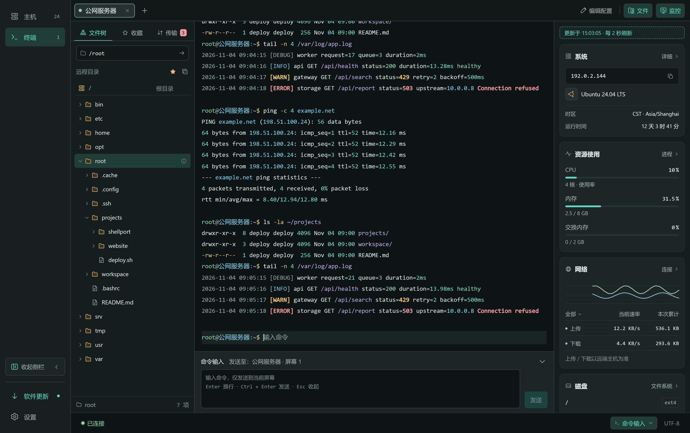
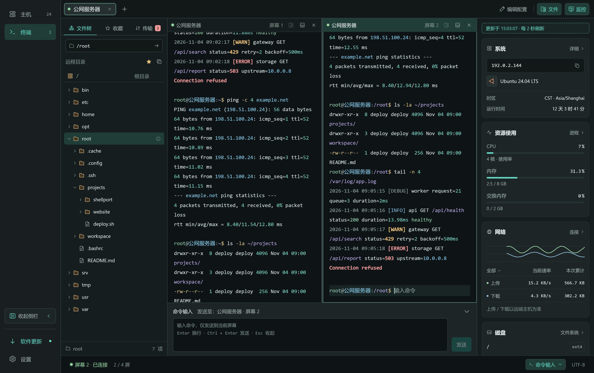
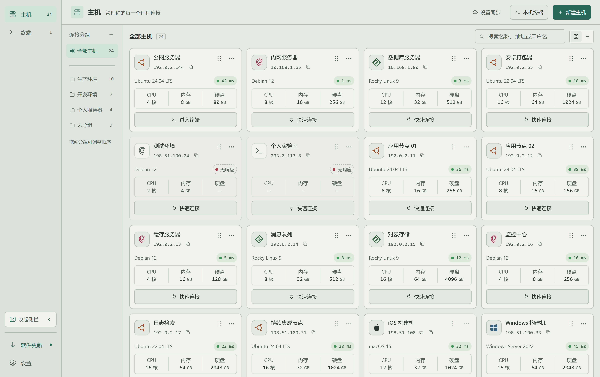

# ShellPort

[简体中文](README.md) · **English**

### Your servers. Your workflow. Connected.

An SSH desktop client for **macOS and Windows**. 
Bring SSH and local terminals, file editing, system monitoring, and configuration backups into one workspace.

**[Download the latest release](https://github.com/conghuahuadan/ShellPort/releases/latest)** · [Product website](https://conghuahuadan.github.io/ShellPort/en.html) · [Release notes](https://github.com/conghuahuadan/ShellPort/releases) · [Feedback](https://github.com/conghuahuadan/ShellPort/issues)

macOS / Windows · Intel / Apple Silicon / ARM64 · Dark / Light

## From connection to action, in one place

Watch resource usage while reading logs. Manage remote files right beside the terminal while deploying a project. ShellPort brings these everyday tasks together so you can stay focused on the work.

| Feature | What you can do |
| --- | --- |
| **Host management** | Group, search, and sort hosts, diagnose connections, and reconnect manually. Use passwords or OpenSSH/PEM keys added by file selection, drag and drop, or paste. |
| **Terminal workspace** | Switch and reorder tabs, work independently in horizontal or vertical splits, and search the current pane’s output. Native local shells include local file and monitoring panels. |
| **Files and transfers** | Browse SFTP directories, bookmark paths, edit permissions, drop files to upload, and upload folders as archives. Pause, resume, or retry transfers and see transfer speeds. Edit local or remote text with save conflict checks and draft export. |
| **System monitoring** | Keep CPU, memory, network, and disk activity beside the terminal. Explore processes, connections, and file systems. Available metrics depend on the target system and permissions. |
| **Backup and sync** | Export and import selected configuration, review conflicts, and retain recovery snapshots. Use your own HTTPS WebDAV service for encrypted configuration sync and cloud backup creation and recovery. |
| **Appearance and updates** | Choose Chinese or English, dark or light themes, terminal fonts, and shortcuts. Remember window placement, optionally keep work running in the background with tray/menu bar access, install verified updates, and export local diagnostic logs. |

## A workspace that keeps you in context

### Work side by side

Each split terminal works independently while the file and monitoring panels stay in view. Read logs in one pane and run commands in another.

### Organized hosts, in any light

Group production, development, and personal servers. Find a host by name, address, or username, and switch to a light theme when it suits your environment.

## Download

Open the **[latest release](https://github.com/conghuahuadan/ShellPort/releases/latest)** and choose the matching file under Assets.

| Your device | Look for | Installation |
| --- | --- | --- |
| Mac · Apple Silicon (M series) | `macos-arm64` | Open the `.dmg` and drag ShellPort into Applications |
| Mac · Intel | `macos-amd64` | Open the `.dmg` and drag ShellPort into Applications |
| Windows · Intel / AMD x64 | `windows-amd64` | Use `-setup.exe`, or extract the portable `.zip` |
| Windows · ARM64 | `windows-arm64` | Use `-setup.exe`, or extract the portable `.zip` |

On a Mac, check your chip in **About This Mac**. On Windows, check **Settings → System → About → System type**. ZIP packages for macOS are also available in the release assets.

**Before installing:** Check the release notes for signing status, system requirements, and installation guidance. Current macOS packages do not have Developer ID signing or Apple notarization, and Windows packages are unsigned, so your system may display a security prompt. The `SHA256SUMS.txt` attachment contains SHA-256 checksums for the packages.

## Get started

1. **Add a host:** Enter the address, port, username, and authentication details, and choose a group if needed.
2. **Open your workspace:** Connect and use the terminal. Open the file and monitoring panels or add a split when you need them.
3. **Keep your configuration:** Export a local backup or configure your own WebDAV service in the backup and sync settings.

You can also open a local terminal directly from the hosts page without creating an SSH host. Its file and monitoring panels use real local data.

The first SSH connection or connection test automatically records the host key for that address and port, without a fingerprint confirmation dialog. Later key changes block the connection.

## Current limits

- Downloads target macOS and Windows; no public Linux package is currently provided.
- Text editing supports regular text files up to 2 MiB. Monitoring metrics and permission operations depend on the system and access rights.
- Jump hosts, SSH agents, hardware keys, keyboard-interactive MFA, and automatic reconnection are not currently supported.
- Backups and sync move configuration, excluding running terminals, transfers, monitoring, local files, and local bookmarks.

## Frequently asked questions

<strong>What is this repository for?</strong>

This is the public download and feedback repository for ShellPort. Find installers, release notes, and product information here, and share issues or suggestions.

<strong>Is cloud sync required?</strong>

No ShellPort account is required. WebDAV is off by default. Connect your own HTTPS service and confirm the scope and initial sync strategy. With valid authorization and no conflicts, sync can run at startup and normal exit; manual sync is also available. Conflicts require confirmation. Built-in cloud and membership services are not currently available.

<strong>Are private keys included in backups or sync?</strong>

No. SSH private keys are encrypted locally and excluded from exports and cloud sync. Add them again on a new device; key passphrases are used only for the current operation. Login passwords are excluded by default and require explicit selection. WebDAV documents are encrypted as a whole. Local JSON exports leave host addresses and other configuration readable; password fields use a built-in portable encryption key, which is not master-password protection. Keep backups safe.

<strong>How do I report an issue or suggest an improvement?</strong>

Open an [issue](https://github.com/conghuahuadan/ShellPort/issues) with your operating system, processor architecture, ShellPort version, steps to reproduce, expected result, and actual result. Screenshots and sanitized logs are helpful. Do not upload passwords, private keys, databases, local encryption key files, or unsanitized logs.

---

**Make every remote session feel more at home.**

[Download ShellPort](https://github.com/conghuahuadan/ShellPort/releases/latest) · [Release notes](https://github.com/conghuahuadan/ShellPort/releases) · [Feedback and ideas](https://github.com/conghuahuadan/ShellPort/issues)

