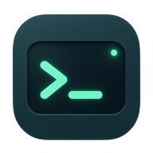
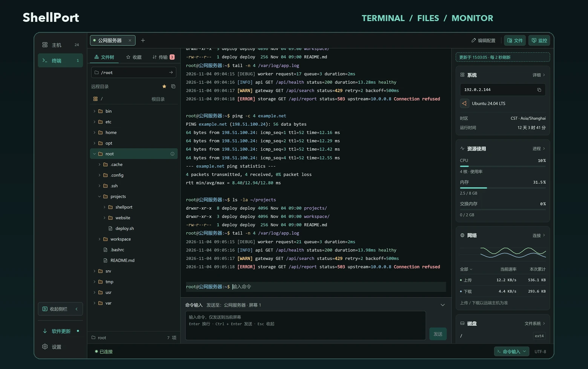
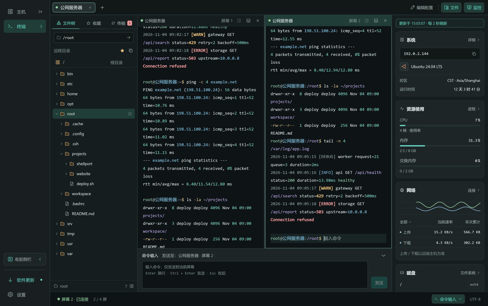
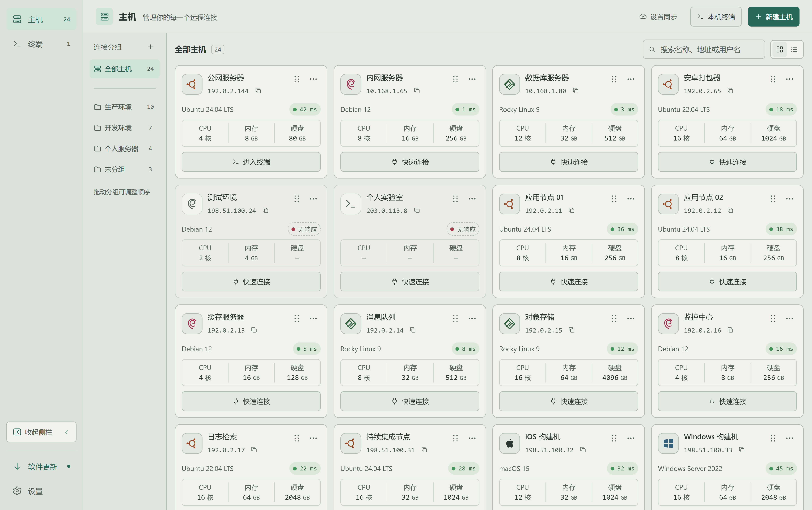

# ShellPort

**简体中文** · [English](README.en.md)

### 连接服务器，也连接你的工作流。

适用于 **macOS 和 Windows** 的 SSH 桌面客户端。 
把 SSH 与本机终端、文件编辑、系统监控和配置备份放进同一个工作空间。

**[下载最新版本](https://github.com/conghuahuadan/ShellPort/releases/latest)** · [产品主页](https://conghuahuadan.github.io/ShellPort/) · [版本更新](https://github.com/conghuahuadan/ShellPort/releases) · [问题反馈](https://github.com/conghuahuadan/ShellPort/issues)

macOS / Windows · Intel / Apple Silicon / ARM64 · 深色 / 浅色

*界面示意包含示例数据；以下按当前实现介绍，下载版本请以对应发布说明为准。*

## 从连接到处理，一处完成

排查服务时，一边查看日志，一边观察资源变化；部署项目时，在终端旁直接管理远程文件。ShellPort 将这些常用操作放在一起，减少来回切换。

| 能力 | 你可以做什么 |
| --- | --- |
| **主机管理** | 按环境或用途整理分组，搜索与排序主机，诊断连接并手动重连；新建终端可搜索最近连接或全部主机。支持密码认证，以及选择、拖入或粘贴 OpenSSH/PEM 私钥。 |
| **终端工作区** | 用标签切换、拖动排序，通过横向/纵向分屏独立操作，查找当前屏幕输出。本机终端使用原生 Shell，并提供本机文件与监控侧栏。 |
| **命令补全与说明** | 输入命令名时，在光标旁查看来自当前连接的候选，支持模糊匹配和中英文离线简介；用方向键选择，Tab / Enter 填入，再次确认执行。 |
| **文件与传输** | 浏览 SFTP 文件树、收藏路径、修改权限，拖放上传文件或打包上传文件夹；传输支持暂停、继续、重试与速度显示。本机/远程文本编辑支持保存冲突检查和草稿副本导出。 |
| **系统监控** | 在终端旁查看 CPU、内存、网络和磁盘状态，进一步查看进程、连接和文件系统。具体指标取决于目标系统及权限。 |
| **备份与同步** | 按范围导出/导入配置，预检冲突并保留恢复快照；通过自己的 HTTPS WebDAV 服务加密同步所选配置、创建和恢复云备份，内置 WebDAV 接入教程。 |
| **外观与更新** | 切换中英文与深浅主题，调整终端字体和快捷键；记忆窗口位置，按需关闭到后台，通过托盘/菜单栏恢复；在应用内检查、下载、校验并安装更新，导出本地诊断日志。 |

## 看看工作空间

### 并排操作，保留上下文

分屏中的终端各自操作，文件与监控侧栏持续可见，适合同时查看日志、执行命令。

### 主机有序，深浅皆宜

将生产、开发和个人服务器分组管理，按名称、地址或用户名查找。喜欢明亮界面时，也可以切换到浅色主题。

### 输入命令时，多一点提示

输入命令名后，可在光标旁选择候选，并查看内置 tldr-pages 命令简介。说明跟随界面语言，中文缺失时回退英文；没有收录的命令会提示未提供说明。

方向键选择，**Tab / Enter 只填入命令名**，松开后再次按 Enter 才执行；Esc 收起。候选来自当前连接的可用命令，不读取 Shell 历史；参数、路径和复杂表达式继续交给 Shell 自身补全。

## 下载

打开 **[最新版本](https://github.com/conghuahuadan/ShellPort/releases/latest)**，在 Assets 中选择适合自己设备的文件。

| 你的设备 | 文件名中选择 | 推荐安装方式 |
| --- | --- | --- |
| Mac · Apple Silicon（M 系列） | `macos-arm64` | `.dmg`，打开后将应用拖入“应用程序” |
| Mac · Intel | `macos-amd64` | `.dmg`，打开后将应用拖入“应用程序” |
| Windows · Intel / AMD x64 | `windows-amd64` | `-setup.exe` 安装版，或 `.zip` 免安装版 |
| Windows · ARM64 | `windows-arm64` | `-setup.exe` 安装版，或 `.zip` 免安装版 |

Mac 可在“关于本机”中确认芯片；Windows 可在“设置 → 系统 → 系统信息”中查看系统类型。macOS 的 ZIP 包也可在对应版本附件中下载。

**安装提示：** 每个版本的签名状态和系统要求以发布说明为准。当前发布包尚未完成 macOS Developer ID 签名与 Apple 公证，Windows 包未签名，首次打开可能出现系统安全提示；请先阅读对应版本说明。`SHA256SUMS.txt` 提供安装包的 SHA-256 校验值。

## 开始使用

1. **添加主机**：点击“新建主机”，填写地址、端口、用户名及认证信息，按需要放入分组。
2. **进入工作区**：连接主机，在终端执行命令；按需要展开文件与监控侧栏，或添加分屏。
3. **带走配置**：在设置的“备份与同步”中导出本地备份，或配置自己的 WebDAV 服务。

本机终端可从主机页直接打开，无需创建 SSH 主机。文件与监控侧栏也会读取本机实际数据。

远程连接首次自动记录该地址与端口的主机密钥，之后密钥变化会阻止连接。首次连接与连接测试均不弹出指纹确认。

## 当前边界

- 下载包面向 macOS 与 Windows；当前没有公开 Linux 安装包。
- 文本编辑面向最多 2 MiB 的普通文本文件；可用监控指标及文件权限操作取决于系统和权限。
- 当前不支持跳板机、SSH agent、硬件密钥、键盘交互式 MFA 或断线自动重连。
- 备份与同步迁移的是配置，不包含运行中的终端、传输或监控；本机文件与本机收藏也不随配置迁移。

## 常见问题

<strong>这个仓库提供什么？</strong>

这里是 ShellPort 的公开下载与反馈仓库，提供安装包、版本更新和使用介绍，也欢迎反馈问题和建议。

<strong>是否必须配置云同步？</strong>

不需要，也无需注册 ShellPort 账号。WebDAV 默认关闭，需要时连接自己的 HTTPS 服务并选择同步范围。确认范围和首次处理策略后，在授权有效且无冲突时启动与正常退出可同步，使用中也可手动同步；遇到冲突需要确认。当前未开放内置云服务或会员服务。

<strong>私钥会随配置备份或同步吗？</strong>

不会。SSH 私钥加密保存在本机，不进入本地导出或云同步，换设备后需要重新提供；私钥口令仅用于当次操作。登录密码默认不纳入备份或同步，需显式勾选。WebDAV 同步文档整体加密，密钥由 WebDAV 密码派生，不宣称服务商不可解密；本地 JSON 中地址等配置为明文，密码字段采用内置便携密钥加密，不等同于主密码保护，请妥善保管备份。

<strong>如何反馈问题或提出建议？</strong>

请在 [Issues](https://github.com/conghuahuadan/ShellPort/issues) 中说明系统版本、处理器架构、ShellPort 版本、操作步骤、预期结果和实际结果。截图或脱敏日志能帮助定位问题。请勿上传密码、私钥、数据库、本机密钥文件或未经脱敏的日志。

---

**让每一次远程操作，都更顺手。**

[下载 ShellPort](https://github.com/conghuahuadan/ShellPort/releases/latest) · [查看更新](https://github.com/conghuahuadan/ShellPort/releases) · [反馈与建议](https://github.com/conghuahuadan/ShellPort/issues)

